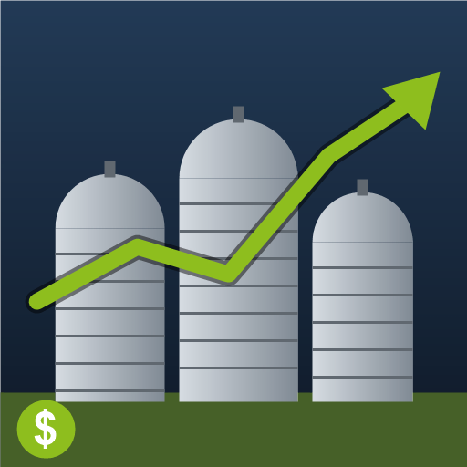

# ModHub upload: Farm Inventory Pro Edition

What to enter in the GIANTS ModHub upload form for this mod. Each text box below has a copy button on GitHub.



**Mod Icon (512x512):** [`icon_512.png`](icon_512.png)

| Field | Value |
|-------|-------|
| Title English | Farm Inventory Pro Edition |
| Title German | Hofinventar Pro Edition |
| Title French | Inventaire de la ferme Pro Edition |
| Version | `0` `7` `2` `1` |
| Author | DTM Mods, PropaineX |
| Manufacturer | Lizard |
| Category 1 | Gameplay |
| Category 2 | Not Set |
| Category 3 | Not Set |

## Title English
```text
Farm Inventory Pro Edition
```

## Title German
```text
Hofinventar Pro Edition
```

## Title French
```text
Inventaire de la ferme Pro Edition
```

## Description English
```text
Adds an INVENTORY tab next to PRICES in the Prices menu. It lists the goods your farm has stored, grouped by where they are kept, with the normal market information next to it: selling stations, prices and price history. See at a glance what each silo, tank, production and animal pen holds, and where to sell it.

- SILO: each silo, with its silo extensions added in. Liquid storage such as milk, water or diesel comes right after the dry silos.
- FEEDING ROBOT: every bin, shown as stored / capacity.
- BUNKER SILO: each bunker silo.
- PRODUCTION: the goods a production makes (inputs are not listed).
- ANIMALS: what is in an animal pen's storage, such as milk or manure.
- HIDE takes a whole location off the list, SHOW HIDDEN brings it back. Your hidden list is saved per player.
- At a silo's fill trigger, the fill type list only shows goods that are actually in stock.
- Works in single player and multiplayer.

How to use: open the Prices menu and select the INVENTORY tab.

Changelog 0.7.2.0:
- Closing the menu from the INVENTORY tab no longer lags, and Esc only needs one press.
- The mouse wheel scrolls the list again.
- The HIDE / SHOW HIDDEN buttons now show up on the INVENTORY tab.
```

## Description German
```text
Fügt im Preise-Menü neben PREISE einen Reiter INVENTORY hinzu. Er listet die Waren, die dein Hof gelagert hat, sortiert nach Lagerort, mit den normalen Marktinfos daneben: Verkaufsstellen, Preise und Preisverlauf. So siehst du auf einen Blick, was in jedem Silo, Tank, jeder Produktion und jedem Tierstall liegt und wo du es verkaufen kannst.

- SILO: jedes Silo, mit seinen Siloerweiterungen zusammengezählt. Flüssigkeitslager wie Milch, Wasser oder Diesel folgen direkt nach den Silos.
- FEEDING ROBOT: jeder Behälter des Fütterungsroboters als Bestand / Kapazität.
- BUNKER SILO: jedes Fahrsilo.
- PRODUCTION: die Waren, die eine Produktion herstellt (Zutaten werden nicht gelistet).
- ANIMALS: was im Lager eines Tierstalls liegt, etwa Milch oder Mist.
- HIDE blendet einen ganzen Lagerort aus, SHOW HIDDEN holt ihn zurück. Die Liste gilt pro Spieler.
- Am Befülltrigger eines Silos zeigt die Liste der Fülltypen nur Waren, die wirklich vorrätig sind.
- Funktioniert im Einzel- und Mehrspielermodus.

So geht's: Preise-Menü öffnen und den Reiter INVENTORY wählen.

Changelog 0.7.2.0:
- Das Schließen des Menüs aus dem Reiter INVENTORY ruckelt nicht mehr, Esc reicht einmal.
- Das Mausrad scrollt die Liste wieder.
- Die Schaltflächen HIDE / SHOW HIDDEN erscheinen jetzt im Reiter INVENTORY.
```

## Description French
```text
Ajoute un onglet INVENTORY à côté de PRIX dans le menu des prix. Il liste les marchandises stockées par votre ferme, regroupées par lieu de stockage, avec les informations de marché habituelles : points de vente, prix et historique des prix. Vous voyez d'un coup d'œil ce que contient chaque silo, cuve, production et enclos, et où le vendre.

- SILO : chaque silo, avec ses extensions de silo additionnées. Les stockages de liquides comme le lait, l'eau ou le diesel suivent directement les silos.
- FEEDING ROBOT : chaque bac du robot d'alimentation, affiché en stock / capacité.
- BUNKER SILO : chaque silo couloir.
- PRODUCTION : les marchandises qu'une production fabrique (les intrants ne sont pas listés).
- ANIMALS : le contenu du stockage d'un enclos, comme le lait ou le fumier.
- HIDE masque un lieu entier, SHOW HIDDEN le fait réapparaître. La liste est enregistrée par joueur.
- Au point de chargement d'un silo, la liste des types de remplissage n'affiche que les marchandises en stock.
- Fonctionne en solo et en multijoueur.

Utilisation : ouvrez le menu des prix et choisissez l'onglet INVENTORY.

Changelog 0.7.2.0 :
- Fermer le menu depuis l'onglet INVENTORY ne provoque plus de ralentissement, et une seule pression sur Échap suffit.
- La molette de la souris fait de nouveau défiler la liste.
- Les boutons HIDE / SHOW HIDDEN apparaissent maintenant dans l'onglet INVENTORY.
```

## Before uploading

- The mod itself is English only: modDesc has no German or French title or description, and `translations/` only has `l10n_en.xml`. German and French players see the tab and its buttons in English (INVENTORY, HIDE, SHOW HIDDEN), which is why the German and French descriptions name them in English. The texts here do not add translations to the mod.
